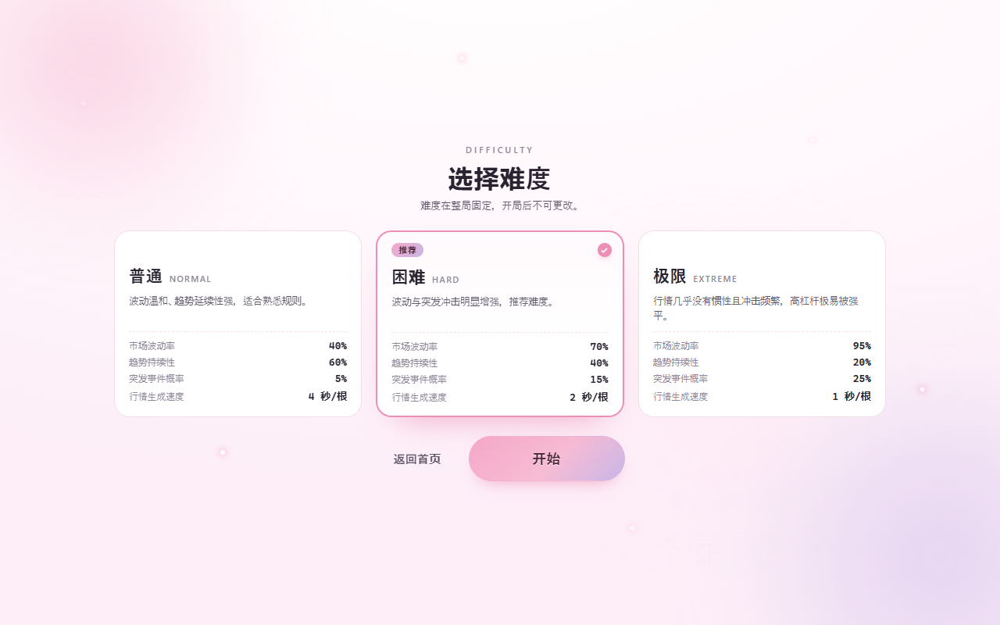
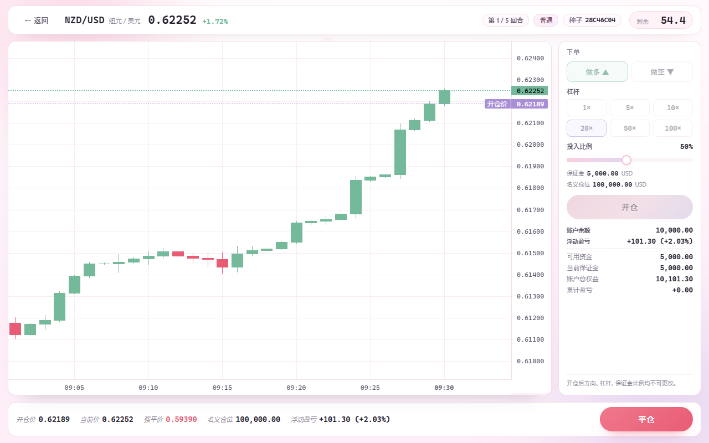
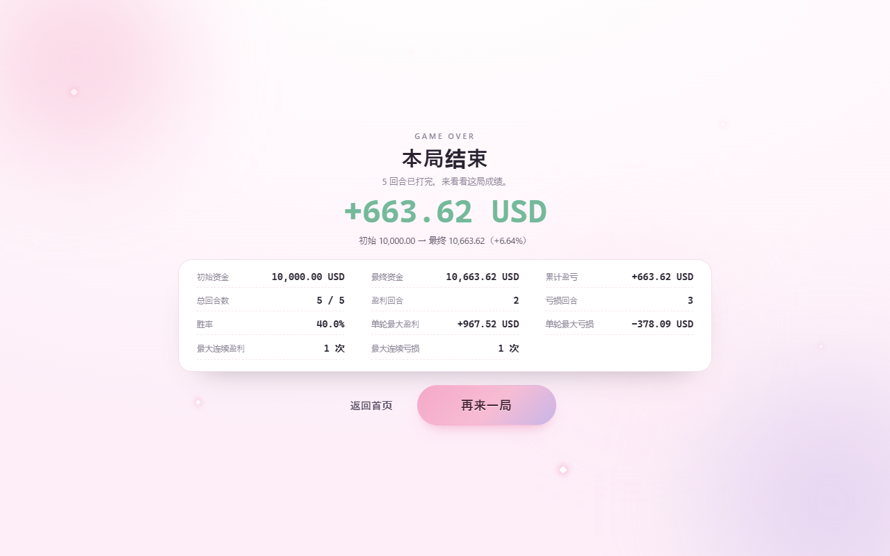

# K线♡过山车

**用虚拟资金，在程序生成的外汇行情里做多做空。60 秒一回合，5 回合定输赢。**

可爱外表，残酷市场 —— 一个纯前端的外汇杠杆模拟交易小游戏。
**完全离线、无需登录、不涉及任何真实资金或真实行情。**


---

## 玩法

1. **选难度**：普通 / 困难 / 极限。难度越高，行情越猛、突发冲击越频繁。整局锁定，不能中途改。
2. **看行情**：每回合随机一个货币对（EUR/USD、GBP/USD、AUD/USD、NZD/USD），先给你 30 根历史 K 线慢慢看。
3. **开仓**：选做多或做空、选杠杆、拖保证金比例。**点开仓之后才开始 60 秒倒计时**，行情也从这一刻开始推进。
4. **盯盘**：浮动盈亏实时跳动。方向、杠杆、保证金比例开仓后就锁死了。
5. **强平警告**：当浮动亏损达到累计保证金的 **90%**，会弹出强平窗口 —— 可以追加保证金续命（次数不限），也可以直接结束这笔交易。
6. **结算**：手动平仓或让 60 秒走完自动平仓。5 回合打完看成绩单（胜率、最大单笔盈亏、最长连胜连败……）。

| 项目 | 数值 |
| --- | --- |
| 初始资金 | 10,000 USD |
| 一局回合数 | 5 回合，每回合 60 秒 |
| 行情周期 | 每根 K 线 = 60 秒模拟时间 |
| 杠杆档位 | 1× / 5× / 10× / 20× / 50× / 100× |
| 投入保证金 | 账户余额的 5% ～ 100%（5% 一档） |
| 手续费 / 点差 | 无 |
| 强平线 | 亏损 = 累计保证金 × 90%，按阈值价成交（**不会穿仓**） |

> **盈亏公式**：`盈亏 = 名义仓位 × (平仓价 − 开仓价) ÷ 开仓价 × 方向`
> 由于名义仓位 = 保证金 × 杠杆，所以 **盈亏相当于保证金的百分比 = 杠杆 × 涨跌幅**。
> 也就是说：100 倍时价格走 0.9% 就爆仓，20 倍要 4.5% 才爆 —— 高杠杆的刺激和危险性都在这里。



---

## 特性

- **行情可复现**：每回合由一个随机种子生成，同一个种子永远得到同一段行情、同一个货币对。
  地址栏加 `?difficulty=hard&seed=7A3F9C21` 就能直接复现某一段行情（方便讨论"这一局"）。
- **行情不针对玩家**：生成函数只接收种子 / 货币对 / 难度，拿不到你的持仓和盈亏，想操纵也操纵不了。
- **所有成交都用收盘价**：开仓、平仓、强平口径一致；只插针不算成交。
- **强平按阈值价成交**：无论行情跳空多远，亏损都锁定在 90% 累计保证金，绝不给负余额。
- **本地存档**：记住上次的难度，保存最近 10 局成绩，首页显示历史最佳一局（LocalStorage，不上传任何数据）。
- **无后端**：纯静态文件，不需要服务器、数据库、账号体系。



---

## 本地运行

游戏是纯静态页面，**不需要安装任何依赖**。但因为用了 ES Modules，不能直接双击 `index.html`（浏览器会拒绝 `file://` 下的模块加载），要用一个本地 HTTP 服务器：

```bash
# 方式一：Python（Windows 上是 py -3）
py -3 tools/serve.py 8130

# 方式二：任意静态服务器
python -m http.server 8130
npx serve .
```

然后打开 <http://127.0.0.1:8130/>。

> 推荐第一种：`tools/serve.py` 会给所有响应加 `no-store`，改完代码刷新就生效，不会被浏览器缓存坑到。

## 部署

纯静态、无构建产物依赖，丢到任何静态托管都能跑（GitHub Pages / Cloudflare Pages / Netlify / Vercel…）。

Cloudflare Pages 的做法：

| 设置 | 值 |
| --- | --- |
| Build command | `node tools/build.mjs` |
| Build output directory | `dist` |

`tools/build.mjs` 只把 `index.html`、`assets/`、`vendor/` 拷进 `dist/`，
所以需求文档、开发脚本、截图不会一起发布出去。

---

## 技术实现

- **纯 HTML / CSS / 原生 JavaScript（ES Modules）**，无框架、无构建工具、无 npm 依赖
- **K 线图**：[TradingView Lightweight Charts](https://github.com/tradingview/lightweight-charts) v4.1.3（Apache-2.0），已内置在 `vendor/`，离线可用
- 模块划分：
  - `market.js` 行情生成（种子随机数 + K 线模型，纯函数）
  - `trading.js` 交易计算（名义仓位、盈亏、强平价）
  - `account.js` 资金账务（余额 / 冻结保证金 / 可用资金 / 权益）
  - `session.js` 一局的状态（5 回合、记录、结束判定）
  - `stats.js` 成绩统计（胜率、连胜、最大单笔盈亏）
  - `storage.js` 本地存档
  - `chart.js` 图表封装 · `trade.js` 交易界面 · `difficulty.js` / `gameover.js` 页面
- **自检**：4 个 Node 脚本、共 138 项断言（行情可复现性、盈亏公式、账务不重复记账、强平数学、统计口径、存档异常降级）

```bash
npm run selftest      # 或 node tools/*-selftest.mjs 逐个跑
node tools/calibrate.mjs   # 3000 回合/难度，输出波动与强平概率的校准表
```



---

## 免责声明

本项目是**虚构的娱乐模拟**，全部行情由程序随机生成，与真实外汇市场无关；
不涉及任何真实资金、充值、提现、开户或投资建议，也与任何真实金融机构无关。

界面中的图标均为自制 SVG，未使用任何第三方角色、立绘或商标素材。

## 许可

目前**未附加开源许可证**（默认保留所有权利）。想二次分发或商用请先联系作者。
如果你只是想自己玩或学习实现，随便看、随便改。

---

<sub>开发维护文档（怎么改代码、参数怎么校准）见 [DEVELOPMENT.md](DEVELOPMENT.md)。</sub>
